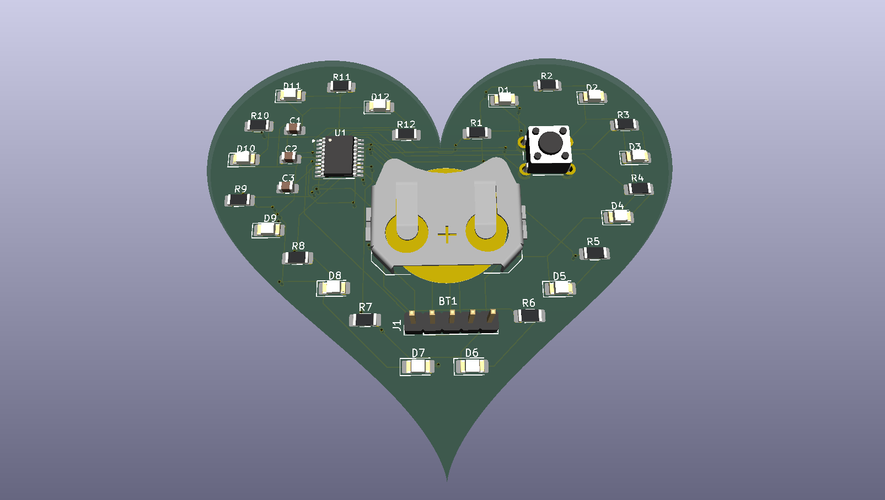

# Heart LED Board

A heart-shaped PCB with 12 red LEDs around the edge. Press the button and the LEDs light up one after the other around the heart, then all of them light for a second at the end. Runs off a CR2032 coin cell and sleeps between presses.

Designed in KiCad, fabricated by JLCPCB, hand soldered.



## Status

- [x] Schematic
- [x] PCB layout (DRC, ERC and schematic parity clean)
- [x] Boards and parts ordered
- [ ] Assembly
- [ ] Firmware
- [ ] Tested

## Specs

| | |
|---|---|
| Board | 70 × 63 mm, 2-layer FR-4, 1.6 mm |
| MCU | STM32G031F6P6 (Cortex-M0+, TSSOP-20) |
| LEDs | 12 × red 1206 (LTST-C150KRKT), 220 Ω each, about 4.5 mA |
| Power | CR2032 coin cell, no regulator |
| Input | One tactile button on PC15 (internal pull-up, wakes the MCU) |
| Programming | 5-pin SWD header (3V3, SWDIO, SWCLK, NRST, GND) |

## How it works

Each LED has its own GPIO pin and resistor, so the MCU can light any LED directly. Only one LED is on at a time during the chase, which keeps the load on the coin cell to about 6.5 mA.

Lighting all 12 at once would pull about 54 mA, which a CR2032 can't supply without the voltage sagging and the MCU browning out. For the "all on" finale, the firmware multiplexes: it cycles through small groups of LEDs fast enough that they all look lit, while the battery only ever sees a few LEDs' worth of current.

Between presses the MCU sits in Stop mode at a few µA. The button wakes it through an EXTI interrupt.

## Pin map

| Signal | MCU pin | Pin # |
|---|---|---|
| LED1–LED8 | PA0–PA7 | 7–14 |
| LED9 | PA8/PB0/PB1/PB2 | 15 |
| LED10 | PA9/PA11 | 16 |
| LED11 | PA10/PA12 | 17 |
| LED12 | PB7/PB8 | 1 |
| Button | PC15 | 3 |
| SWDIO | PA13 | 18 |
| SWCLK | PA14 | 19 |
| NRST | PF2-NRST | 6 |

Pins 1, 15, 16 and 17 have several GPIOs bonded to one physical pin. Only one GPIO per pin should be configured as an output; the rest stay in analog mode.

## Repository layout

```
hardware/      KiCad project (schematic, PCB, project file)
fab/           Gerbers and drill files sent to JLCPCB
docs/          Schematic PDF and BOM
images/        Renders and photos
firmware/      STM32CubeIDE project (coming soon)
```

## Bill of materials

| Ref | Qty | Part | Manufacturer part # |
|---|---|---|---|
| U1 | 1 | STM32G031F6P6 | STM32G031F6P6 |
| D1–D12 | 12 | Red LED, 1206 | LTST-C150KRKT |
| R1–R12 | 12 | 220 Ω, 1206 | RC1206FR-07220RL |
| C1, C3 | 2 | 100 nF, 0805 | CL21B104KBCNNNC |
| C2 | 1 | 4.7 µF, 0805 | CL21A475KAQNNNE |
| SW1 | 1 | 6 mm tactile switch | B3F-1000 |
| BT1 | 1 | CR2032 holder | Keystone 3034 |
| J1 | 1 | 1×5 2.54 mm header | PRPC040SAAN-RC (cut to 5) |

## Programming

The board is flashed over SWD using the ST-Link built into a NUCLEO-G071RB. Remove the two CN4 jumpers on the Nucleo, then wire its CN11 header to J1:

| Nucleo CN11 | J1 |
|---|---|
| 1 VDD_TARGET | 1 3V3 |
| 2 SWCLK | 3 SWCLK |
| 3 GND | 5 GND |
| 4 SWDIO | 2 SWDIO |
| 5 NRST | 4 NRST (optional, needs SB19 opened on the Nucleo) |

The heart runs on its own coin cell while programming. VDD_TARGET only senses the target voltage.

## What I'd change in a rev 2

- More even LED spacing around the outline (the gaps currently range from about 7 mm to 19 mm; the firmware compensates by scaling the step delay to each gap)
- A ground pour on the back layer
- Decoupling caps closer to the VDD pin

## License

Hardware: [CERN-OHL-P v2](https://ohwr.org/cern_ohl_p_v2.txt)
Firmware: MIT
